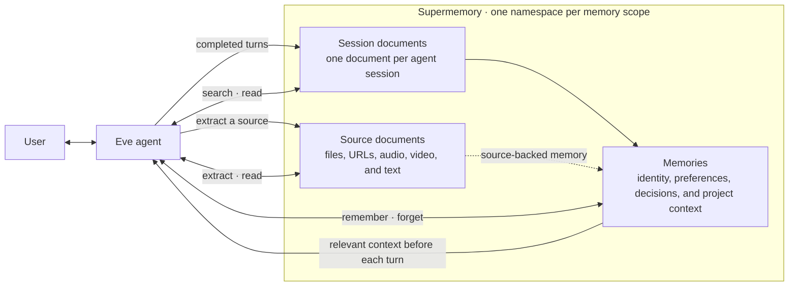

# Supermemory for Eve

`@supermemory/eve` is the first third-party implementation of
[Eve's memory-provider contract](https://eve.dev/docs/memory), powered by
[Supermemory](https://supermemory.ai).

Once mounted, it captures completed conversations, recalls useful context before each turn, and
gives Eve tools to search, remember, extract, and forget.

## Add memory to Eve

```bash
npm install @supermemory/eve eve
```

Or let Eve install the package and write the memory slot for you:

```bash
eve add memory/supermemory
```

`@supermemory/eve` 0.2 supports Eve 1.x, from 1.0 through the current 1.2, and uses the
Supermemory v5 API. Eve is a peer dependency, so your application's Eve runtime owns the memory
lifecycle. Set `SUPERMEMORY_API_KEY` from the [Supermemory console](https://console.supermemory.ai).

Still on Eve 0.x? Pin the previous provider. npm refuses to pair 0.2 with Eve 0.x instead of
installing a mismatched runtime:

```bash
npm install @supermemory/eve@0.1.3
```

Create a memory slot in the consuming Eve agent. `supermemory(...)` configures the provider;
`defineMemory(...)` binds it to an Eve-managed scope.

```ts
// agent/memory/supermemory.ts
import supermemory from "@supermemory/eve";
import { defineMemory } from "eve/memory";
import { byPrincipal } from "eve/memory/scope";

export default defineMemory({
  namespace: "your-company-agent-v1",
  description: "Recall and manage durable context for the current user.",
  provider: supermemory({
    apiKey: () => process.env.SUPERMEMORY_API_KEY!,
  }),
  scope: byPrincipal,
});
```

Pass `apiKey` as a function so the key is read when the agent runs, not when `eve build` loads the
slot. A plain string also works, but then the key must be set in the build environment too.

Pick a namespace for the agent and keep it stable. If it changes, Eve sees a different memory space.
`description` is added to the tool descriptions the model sees, so keep it short and say what this
memory is for.

## How it works



A session document is the record of one agent session. New successful turns are appended to it;
failed or cancelled turns are not. Source documents hold material that SuperRAG has parsed or
transcribed for later reading. Memories are the smaller durable facts and decisions Supermemory
forms from those documents.

Eve combines the slot's namespace and trusted scope into an opaque, locked memory-scope key. The
provider derives its Supermemory namespace from that key and uses it for every read and write. The
application decides whether the scope represents one user, a workspace, or another trusted
boundary; the model cannot choose or change it.

## Automatic continuity

After each successful turn, the provider appends the user and assistant messages to that session's
document. Failed and cancelled turns are discarded. Supermemory forms durable memories from
user-grounded details such as preferences, relationships, goals, decisions, constraints, and
ongoing work.

When a turn uses a Supermemory tool, retrieved material is marked as existing context. It cannot be
learned again from the assistant's response.

Before each turn, the provider loads the user's current Supermemory profile and automatically
searches for context relevant to the request. Eve 1.x keeps recalled context outside conversation
history, so compaction preserves it without calling a post-compaction recall hook. The agent can
still use the search and read tools when it needs broader or source-level context.

## Agent-directed memory

The provider exposes a small set of scope-bound tools for searching, reading, remembering,
extracting, and forgetting context.

| Workflow | Tools | Used for |
| --- | --- | --- |
| Search | `search`, `read_session`, `read_document` | Search compact results first, then read the full session or source only when the task needs it. |
| Remember | `remember` | Save an explicit request, preference, decision, project state, or reusable correction as one standalone memory. |
| Extract | `extract`, `read_document` | Use SuperRAG to parse, transcribe, index, and selectively read large or unsupported sources. |
| Forget | `search`, `forget`, `forget_matching` | Remove one exact memory, or preview and confirm the precise set for a broader request. |

Naming the memory slot `supermemory.ts` gives its provider tools the `supermemory__` namespace, so
`search` becomes `supermemory__search`.

Source-backed memories keep the useful synthesis and the source document ID. The agent can answer
from the memory when it is enough and return to the original evidence when it is not.

## Design choices

- Capture does not depend on the model remembering to remember.
- Session documents preserve what was actually said; memories preserve what remains useful.
- Source documents stay available without occupying the agent's full context window.
- Automatic search handles routine recall while tools support deliberate retrieval and changes.
- Identity and storage routing stay under developer control.
- Broad deletion always exposes the affected memories before changing them.

## Configuration

The namespace, description, and scope belong to the Eve memory slot. Provider options are passed to
`supermemory(...)`. Automatic search and capture are enabled by default and can be disabled
independently:

```ts
export default defineMemory({
  namespace: "your-company-agent-v1",
  description: "Recall and manage durable context for the current user.",
  provider: supermemory({
    apiKey: () => process.env.SUPERMEMORY_API_KEY!,
    containerTagPrefix: "eve_agent",
    autoSearch: {
      enabled: true,
    },
    capture: {
      enabled: true,
      dreaming: "dynamic",
      metadata: {},
    },
  }),
  scope: byPrincipal,
});
```

`capture.supportingContext` can replace the default definition of durable context. The existing
`capture.entityContext` option remains an alias; `supportingContext` takes precedence if both are
set. The model cannot change caller identity, namespace routing, or capture policy at runtime.

### Subagents and scheduled runs

Automatic recall and capture skip two kinds of session by default, so they make no Supermemory
calls:

- Child sessions, which Eve marks with `session.parent`: declared subagents, copies started by the
  built-in `agent` tool, and `ctx.agent(...)` workflow calls. A remote agent's session carries the
  parent link only when its `eveChannel({ trustedForwarders })` accepts the calling deployment.
  A child keeps `session.parent` for its whole life, so turns a person sends to it by continuing
  it with its `taskId` are skipped too unless `captureSubagents` is on.
- Scheduled runs, which Eve marks with `session.schedule`. A later message from a person in the
  same session clears that mark, so those turns are recalled and captured as usual. Approval and
  input responses keep the mark. `captureHeadless` covers only these scheduled runs.

To recall and capture them as before, set the matching option or environment variable. Each one
turns on both recall and capture for its kind of session. The environment variable wins over the
option in both directions when it is set to `true`, `1`, `yes`, `on` or `false`, `0`, `no`, `off`.

```ts
supermemory({
  apiKey: () => process.env.SUPERMEMORY_API_KEY!,
  captureSubagents: true, // or SUPERMEMORY_CAPTURE_SUBAGENTS=true
  captureHeadless: true, // or SUPERMEMORY_CAPTURE_HEADLESS=true
});
```

The provider tools stay available in every session, because the model calls them on purpose.

## Upgrading an existing Eve 1.x installation

Keep the Eve slot's `namespace`, scope resolver, and `containerTagPrefix` unchanged. The legacy
prefix option keeps its name and default (`eve_agent`), but its values now identify v5 namespaces:
`<prefix>_<opaque-scope-key>` for context and `<prefix>_extraction_<opaque-scope-key>` for sources.
These are exactly the previous container-tag values. The provider does not move, copy, or delete
existing data; v5 accesses the same namespace. Session and source IDs also stay unchanged.
Do not change these settings to "migrate" an existing installation: that would select empty storage.

Search keeps the existing `scope` and `customId` inputs and the `results[].documents[]` source
references used by the read tools. The `documents` search scope now uses v5 chunk search. Read
tools retain `customId`, `status`, and timestamp aliases while also returning v5 `system` details.
Profiles read the text from v5's structured memory entries. Fields that v5 no longer exposes
on document reads (`connectionId`, `taskType`, `source`, `url`, and `filepath`) are not fabricated
in tool responses; the original stored data is not rewritten.

Broad forgetting still previews first and finalizes only the exact confirmed IDs; it never
re-runs the natural-language query to delete. `maxForget` caps the displayed preview. An optional
`threshold` narrows it to up to 100 scored memory-search matches. V5 does not return candidate
scores or batch IDs from topic previews; `forgetBatchId` is therefore null. Deletion `reason`
inputs are returned to the caller, not persisted as server-side audit reasons in v5.

## Frequently asked questions

### How do I add memory to Eve?

Install `@supermemory/eve`, get an API key from the
[Supermemory console](https://console.supermemory.ai), and add the memory file shown above. That's
it. Eve loads Supermemory as its memory provider.

### Why should I add memory to Eve?

Without memory, a new session starts over. Supermemory carries forward things like preferences,
decisions, project context, and earlier conversations so the agent can pick up where it left off.

### Does Eve remember conversations automatically?

With Supermemory installed, yes. Completed turns are captured automatically and useful context is
extracted from them. Failed and cancelled turns are ignored.

### How do I add RAG to an Eve agent?

Install the same provider. SuperRAG handles PDFs, URLs, images, audio, video, and text, so the agent
can index a source, search it later, and return to the original document when it needs more detail.
There is no separate RAG setup.

File extraction accepts only Eve-staged paths under `/workspace/.eve/attachments/`. The
provider passes the tool cancellation signal to Eve's binary-file read and to the Supermemory
upload. Hosted attachment turns still need an end-to-end check before release.

## Upgrading an existing integration to Eve 1.0

Follow [Eve's upgrade guide](https://eve.dev/docs/guides/upgrade) for your agent and deployment.
This package is a memory provider, not an Eve extension, so it has no extension distribution
manifest to rebuild.

Keep your memory slot name, explicit namespace, trusted scope resolver, and `containerTagPrefix`
unchanged. The provider derives the same storage partition, session document IDs, and source
metadata as before; it does not rewrite or migrate stored documents.
Eve's default namespace includes deployment identity, so changing the application root or
Preview identity can still select a different partition. Preserve your existing identity rather
than inventing a new namespace during the upgrade.

The provider still uses Eve's memory lifecycle keys `turn.started` and `turn.completed`.
These are provider callbacks, not raw v26 session-stream consumers: do not rename capture to
`turn.settled`. Eve calls completed-turn capture only for a successfully completed turn.
It preserves recalled messages outside history during compaction, replacing the old
`compaction.completed` recall callback.

This package stores conversation text and source documents, not raw Eve session events.
It needs no v26-to-v27 event conversion. Applications that archive Eve events themselves must
follow Eve's saved-history migration separately, retain their originals, and keep old deployments
running for existing sessions as the upgrade guide requires.

The `0.2` line is the npm `latest` release. It is outside existing `^0.1.3` and `~0.1.3` ranges, so an
Eve 0.x application keeps resolving `0.1.3` until you upgrade Eve and the provider together.
Applications that installed a `0.2.0` release candidate receive the current `0.2` release on their
next update and keep their stored memory. Upgrading an agent to Eve 1.x without the matching
provider is unsupported.

From `0.2.1`, automatic recall and capture no longer run in child sessions and scheduled runs.
Nothing already stored changes. Applications that relied on memory in those sessions set
`captureSubagents` or `captureHeadless`; see [Subagents and scheduled runs](#subagents-and-scheduled-runs).

## Development

Requires Node.js 24 or newer.

```bash
npm install
npm run check
npm run typecheck
npm run build
npm pack --dry-run
```

### Publishing

Pushes to `main` run the release workflow. **Merging a version bump can publish automatically.**
After checks and a packaged-import smoke test pass,
the workflow publishes the version in `package.json` if it is not already on npm. Bump the
package version and update `package-lock.json` to ship a new release; no Git tag is required.
The workflow reads the npm tag from `publishConfig.tag`, permits only `next` and `latest`,
and refuses to publish a prerelease to `latest`. Stable releases set `tag: "latest"`; a
prerelease must set `tag: "next"`. The workflow does not move other dist-tags, so after a stable
release a maintainer moves `next` with `npm dist-tag add @supermemory/eve@<version> next`.
A local `npm publish --dry-run` checks the package without publishing it.

Publishing uses npm trusted publishing with GitHub Actions OIDC; no `NPM_TOKEN` secret is needed.
In the npm package's trusted publisher settings, select GitHub Actions, set the organization to
`supermemoryai`, the repository to `eve-supermemory`, and the workflow filename to `release.yml`.
Leave the environment name empty and allow direct `npm publish`. The release job uses a
GitHub-hosted runner because npm trusted publishing does not support self-hosted runners.
